# affinity-axi examples

Generated by `npm run examples:gen`. Every example uses the invented demo brand Lumen Studio with Helvetica.
Each folder holds `example.json`, `command.sh`, `output.txt` (normalised stdout) and the files the commands made.

## Home view

`home`: Show whether Affinity is reachable, the open documents and the next commands

```
affinity-axi
```

```
affinity-axi: bin/affinity-axi.js — drive Affinity by Canva through its MCP server: scripts by path, renders to disk, ML helpers, generative AI opt-in per run
affinity: connected
url: http://[::1]:6767
version: 3.3.1.4940
documents[0]{uuid,title,dirty,units}:
filesystem: desktop-only
```

## Run a script

`run`: Run a script from disk against the demo document; failures are reported as failures

```
affinity-axi run examples/run/script.js --args '{"uuid":"$DOC"}'
```

```
script: examples/run/script.js
status: ok
ms: <n>
output[1]:
  added: 1 rectangle
help[2]:
```

## Render a preview

`render`: Preview the current spread as a JPEG on disk


```
affinity-axi render $DOC
affinity-axi render $DOC --out examples/render/render.jpg
```

```
render: .affinity-axi/renders/<uuid8>-s0.jpg
doc: <uuid>
spread: 0
bytes: <n>
size: 1024x1024
note: preview capped at 1024px; use export for full resolution
```

## Export a document

`export`: Export the whole document as a PNG with a validated preset name


```
affinity-axi export $DOC PNG examples/export/demo.png
```

```
export: examples/export/demo.png
doc: <uuid>
preset: PNG
bytes: <n>
size: 1080x1080
alt: (none; add one)
```

## Export every artboard

`export-area`: Export one file per artboard; the path holds {name} for the artboard name


```
affinity-axi export $DOC PNG examples/export-area/{name}.png --all-artboards
```

```
doc: <uuid>
preset: PNG
exports[1]{artboard,path,bytes,size,alt}:
  ig-square,examples/export-area/ig-square.png,<n>,1080x1080,(none; add one)
help[1]:
  edit the alt text before publishing
```

## Export one artboard at 2x

`export-size`: Export a single artboard by name at twice its size with --scale

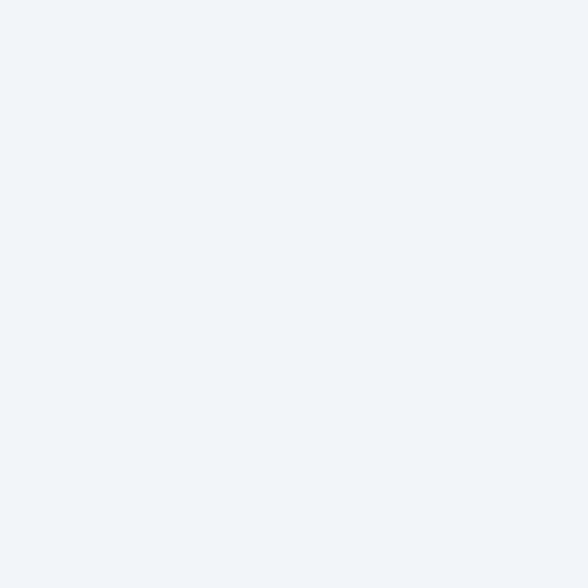

```
affinity-axi export $DOC PNG examples/export-size/ig-square@2x.png --artboard ig-square --scale 2
```

```
export: examples/export-size/ig-square@2x.png
doc: <uuid>
preset: PNG
artboard: ig-square
bytes: <n>
size: 2160x2160
```

## List export presets

`presets`: List the export preset names of this install (the names are localized)

```
affinity-axi presets
```

```
presets[62]{name}:
  PNG
  PNG-8 (dithered)
  "PNG-HDR (PQ, Rec.2020, Full range)"
  "PNG-HDR (PQ, Rec.2020, Narrow range)"
  "PNG-HDR (HLG, Rec.2020, Full range)"
```

## List SDK documentation

`docs`: List SDK documentation topics grouped as modules, examples, tests and data

```
affinity-axi docs
```

```
modules[69]:
  application.js
  artboardinterface.js
  artboardproperties.js
  baseboxinterface.js
  blendmodeinterface.js
```

## Read a documentation topic

`docs-read`: Read part of an SDK topic by line range, so the whole text stays out of context

```
affinity-axi docs read preamble --lines 1-5
```

```
topic: preamble
size: 4201 chars, 48 lines
lines: 1-5
content:
  System preamble:
  This is a JavaScript SDK for the Affinity by Canva application.
```

## Search SDK hints

`hint-search`: Search Affinity's own SDK hints for a task

```
affinity-axi hint search "export a document to PNG"
```

```
prompt: export a document to PNG
hints:
  To export a document to PNG using Affinity JavaScript, here's the basic approach:
  1. **Import the required modules** from '/document':
     - FileExportOptions
     - FileExportArea
```

## Record an SDK hint

`hint-add`: Add a hint to Affinity's hint store (a mutation, so run it deliberately)

```
affinity-axi hint add "Name artboards with axiArtboard so export --all-artboards can use {name}"
```

```
hint: added
```

## List library scripts

`library-list`: List the titles in Affinity's script library

```
affinity-axi library
```

```
scripts[1]{title}:
  Lumen Studio demo
help[1]:
  affinity-axi library read "Lumen Studio demo" --out <file>
```

## Read a library script

`library-read`: Copy a library script to a file so its code stays out of context

```
affinity-axi library save examples/library-read/script.js --title "Lumen Studio demo" --description "Draws one rectangle"
affinity-axi library read "Lumen Studio demo" --out examples/library-read/library-copy.js
```

```
library: saved
title: Lumen Studio demo
help[1]:
  affinity-axi library read "Lumen Studio demo" --out <file>
file: examples/library-read/library-copy.js
bytes: <n>
```

## Save a script to the library

`library-save`: Save a script file into Affinity's library; an identical title and code is a no-op

```
affinity-axi library save examples/library-save/script.js --title "Lumen Studio demo" --description "Draws one rectangle"
```

```
library: already saved (no-op)
title: Lumen Studio demo
help[1]:
  affinity-axi library read "Lumen Studio demo" --out <file>
```

## Check the session-start hook

`setup-hooks`: Report whether the session-start hook is installed, without writing anything

```
affinity-axi setup hook --file examples/setup-hooks/hooks.json --check
```

```
hook: not installed
file: examples/setup-hooks/hooks.json
command: bin/affinity-axi.js --brief
```

## Find a font by exact name

`fonts`: List installed fonts with the exact postscript names scripts need

```
affinity-axi fonts --grep "^Helvetica-Bold$"
```

```
fonts[1]{family,postscript,style}:
  Helvetica,Helvetica-Bold,Bold
help[1]:
  apply: const font = FontFamily.all.flatMap(f => f.fonts).find(f => f.postscriptName === 'Helvetica-Bold'); then StoryDelta.createFont(FontField.PostscriptName | FontField.FamilyName, font)
```

## Create a document

`doc-new`: Create a new document of a given size; a fresh document is clean and closes without a prompt

```
affinity-axi doc new --width 800 --height 600
```

```
doc: <uuid>
size: 800x600 px @ 72 dpi
units: Pixel
dirty: false
help[3]:
  affinity-axi run <script.js> --args '{"uuid":"<uuid8>"}'   # draw into it
```

## Save a document

`doc-save`: Save a document as a .af file under the Desktop folder; it is clean afterwards

```
affinity-axi doc save $DOC examples/doc-save/demo.af
```

```
saved: examples/doc-save/demo.af
doc: <uuid>
bytes: <n>
dirty: false
manifest: demo.af.axi.json
help[2]:
```

## Close a saved document

`doc-close`: Close a document after saving it; closing an unsaved one is refused so no prompt can hang Affinity

```
affinity-axi doc save $DOC examples/doc-close/demo.af
affinity-axi doc close $DOC
```

```
saved: examples/doc-close/demo.af
doc: <uuid>
bytes: <n>
dirty: false
manifest: demo.af.axi.json
help[2]:
```

## List script helpers

`helpers`: List the axi* helpers that --with-helpers adds to a script (offline)

```
affinity-axi helpers
```

```
helpers[58]{name,signature,summary}:
  axiHex,"axiHex(hex, alpha?)",'#RGB' or '#RRGGBB' to an RGBA8; alpha 0-1 (default 1; a value 2-255 is taken as a byte)
  axiDoc,"axiDoc(w, h, dpi?)",new pixel document (1 unit = 1 px at 72 dpi)
  axiFont,axiFont(postscript),find a font by postscriptName (cached); throws with near matches
  axiText,"axiText(doc, {x,y,text,font,size,colour,spacing,align,maxW,name})","one text line, y is the baseline; align l|c|r anchors x; name sets the node's userDescription; returns the node"
  axiParagraph,"axiParagraph(doc, {x,y,w,h,text,font,size,colour,lead,spacing,align,name})","wrapped text in a frame (top-left x,y); lead is relative leading, default 1.5; align l|c|r|j; name sets the node's userDescription"
```

## Helpers: text

`helpers-text`: Add a headline in Helvetica-Bold and a body paragraph that shrinks to fit its box


```
affinity-axi run examples/helpers-text/script.js --with-helpers --args '{"uuid":"$DOC"}'
affinity-axi render $DOC --out examples/helpers-text/render.jpg
```

```
script: examples/helpers-text/script.js
status: ok
ms: <n>
output[1]:
  {"added":["bg","headline","headline-2","body"],"bodySize":52,"lines":4}
help[2]:
```

## Helpers: shapes

`helpers-shapes`: Draw a rounded rectangle and an ellipse with hex fills and names


```
affinity-axi run examples/helpers-shapes/script.js --with-helpers --args '{"uuid":"$DOC"}'
affinity-axi render $DOC --out examples/helpers-shapes/render.jpg
```

```
script: examples/helpers-shapes/script.js
status: ok
ms: <n>
output[1]:
  {"added":["card","sun","pill","rule"]}
help[2]:
```

## Helpers: images

`helpers-image`: Place a photo with cover fit, rounded corners and a focus point

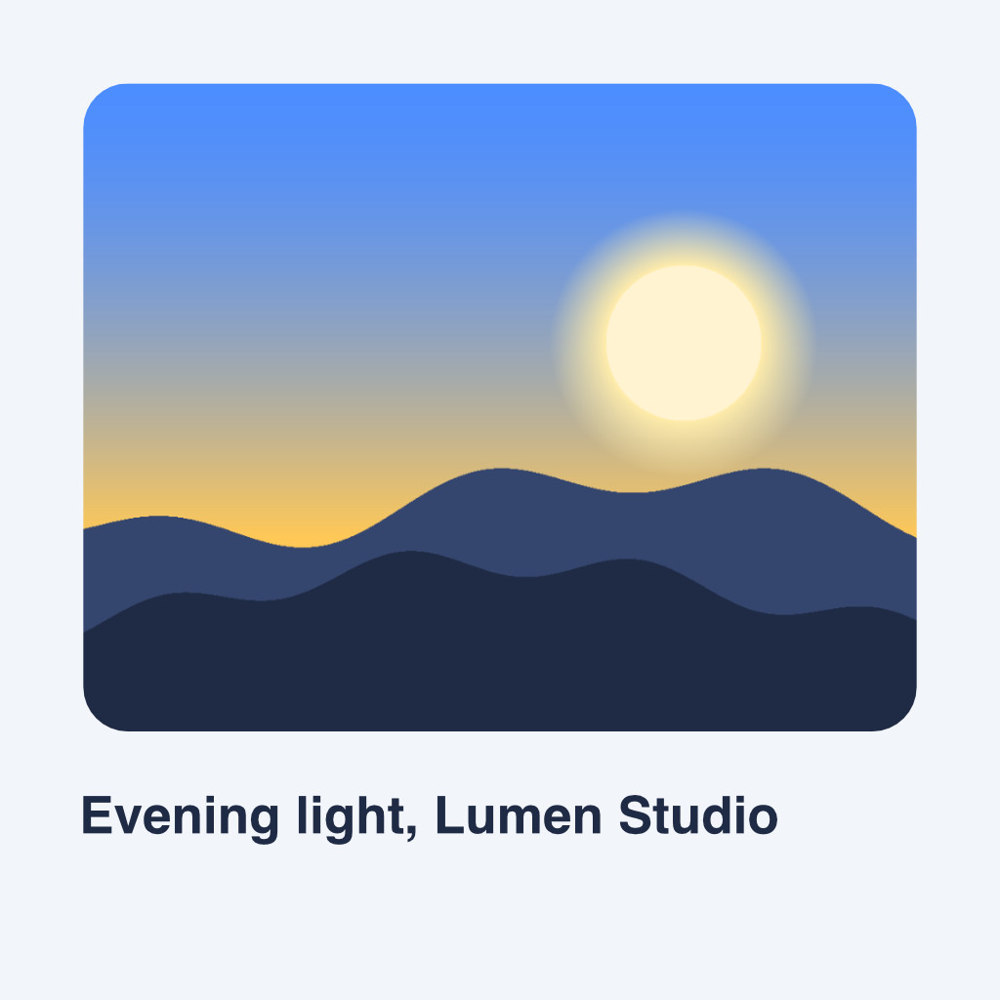

```
affinity-axi run examples/helpers-image/script.js --with-helpers --args '{"uuid":"$DOC"}'
affinity-axi render $DOC --out examples/helpers-image/render.jpg
```

```
script: examples/helpers-image/script.js
status: ok
ms: <n>
output[1]:
  {"added":["bg","photo","caption"]}
help[2]:
```

## Helpers: layout

`helpers-layout`: Artboards from platform sizes, photos fitted per board, text fitted to a box, and a platform's safe zone

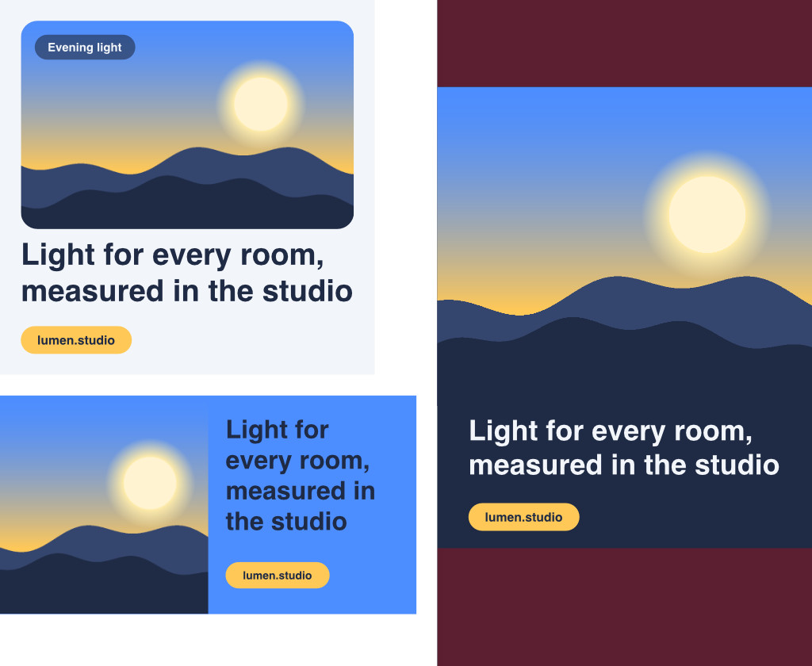

```
affinity-axi run examples/helpers-layout/script.js --with-helpers --args '{"uuid":"$DOC"}'
affinity-axi render $DOC --out examples/helpers-layout/render.jpg
```

```
script: examples/helpers-layout/script.js
status: ok
ms: <n>
output[1]:
  {"artboards":["ig-square","og","story"],"headline":{"size":87.5,"lines":2}}
help[2]:
```

## Helpers: one design, every size

`helpers-variants`: Adapt a master artboard to story and OG boards, or draw each size from one function

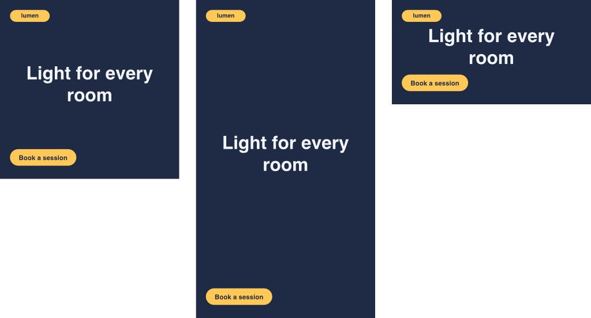

```
affinity-axi run examples/helpers-variants/script.js --with-helpers --args '{"uuid":"$DOC"}'
affinity-axi render $DOC --out examples/helpers-variants/render.jpg
affinity-axi export $DOC PNG examples/helpers-variants/{name}.png --all-artboards
```

```
script: examples/helpers-variants/script.js
status: ok
ms: <n>
output[1]:
  {"route":"adapt","mode":"anchor","boards":["story 1080x1920","og 1200x630"],"clamped":[],"names":["ig-square/headline","ig-square/cta","ig-square/cta-label","story/headline@story","story/cta@story","story/cta-label@story","og/headline@og","og/cta@og","og/cta-label@og"]}
help[2]:
```

## Helpers: carousel

`helpers-carousel`: Five numbered slides with a swipe cue, exported in order

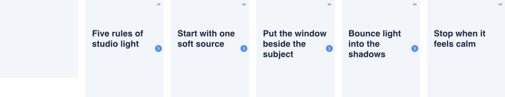

```
affinity-axi run examples/helpers-carousel/script.js --with-helpers --args '{"uuid":"$DOC"}'
affinity-axi render $DOC --out examples/helpers-carousel/render.jpg
```

```
script: examples/helpers-carousel/script.js
status: ok
ms: <n>
output[1]:
  {"slides":["slide-01","slide-02","slide-03","slide-04","slide-05"]}
help[2]:
```

## Helpers: charts

`helpers-charts`: Bars, a donut with a centre label, and progress as a bar and a ring from plain numbers

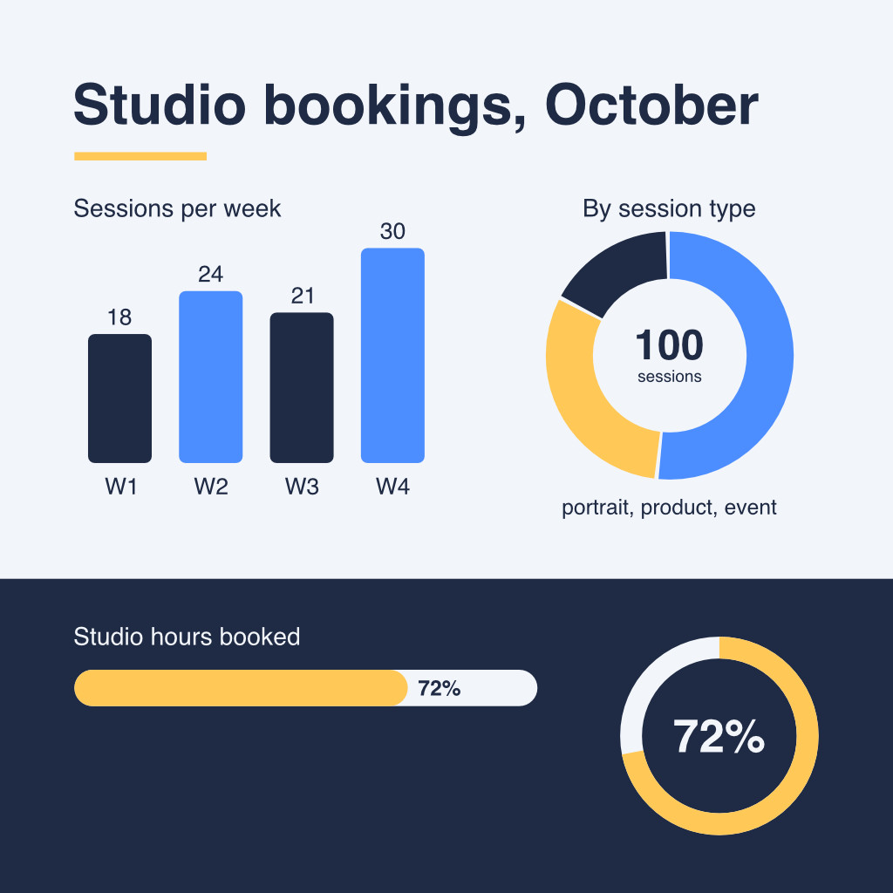

```
affinity-axi run examples/helpers-charts/script.js --with-helpers --args '{"uuid":"$DOC"}'
affinity-axi render $DOC --out examples/helpers-charts/render.jpg
```

```
script: examples/helpers-charts/script.js
status: ok
ms: <n>
output[1]:
  {"bars":4,"slices":3,"progress":0.72}
help[2]:
```

## Web asset bundle

`webassets`: Favicons, OG and X cards and @1x/@2x sets from named artboards, with head.html and a manifest


```
affinity-axi run examples/webassets/script.js --with-helpers --args '{"uuid":"$DOC"}'
affinity-axi render $DOC --out examples/webassets/render.jpg
affinity-axi webassets $DOC --out-dir examples/webassets/site --responsive hero
```

```
script: examples/webassets/script.js
status: ok
ms: <n>
output[1]:
  {"artboards":["mark","og","x-card","hero"]}
help[2]:
```

## Helpers: seal and arc text

`helpers-seal`: A promo seal: burst, ring, text on the top and bottom arcs and stacked centre lines

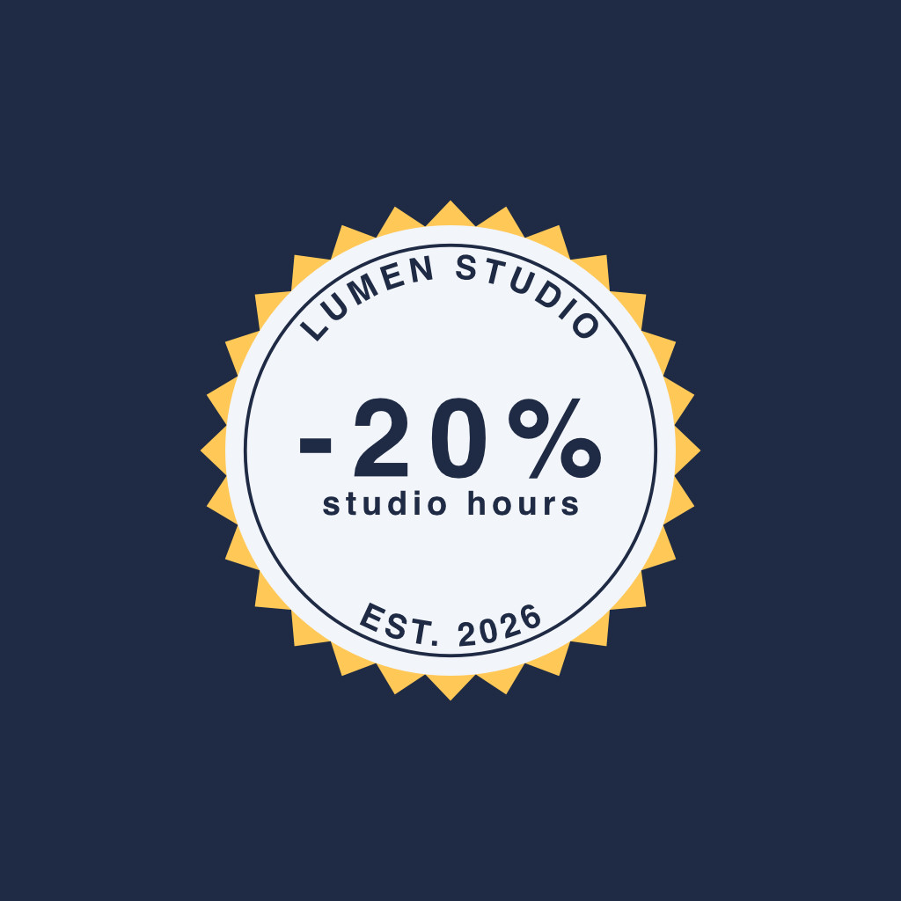

```
affinity-axi run examples/helpers-seal/script.js --with-helpers --args '{"uuid":"$DOC"}'
affinity-axi render $DOC --out examples/helpers-seal/render.jpg
```

```
script: examples/helpers-seal/script.js
status: ok
ms: <n>
output[1]:
  {"parts":["burst","ring","top","bottom","centre"]}
help[2]:
```

## List brand kits

`brand-list`: List this project's kits (./brands/*.brand.json, ./brand.json, $AFFINITY_AXI_BRAND) without connecting

```
affinity-axi brand list
```

```
brands: 0 found
help[1]:
  affinity-axi brand init <name>   # writes ./brands/<name>.brand.json
```

## Show a brand kit

`brand-show`: Print a kit's colours, fonts, type styles and contrast pairs without connecting

```
affinity-axi brand show examples/_brand/brand.json
```

```
name: Lumen Studio
path: examples/_brand/brand.json
sha256: 98c5d6f26f37
colours[4]{key,hex}:
  ink,#1F2A44
  sky,#4C8DFF
```

## Check a brand kit

`brand-check`: Check that the kit's fonts are installed, its logo is readable and its colour pairs have enough contrast

```
affinity-axi brand check examples/_brand/brand.json
```

```
name: Lumen Studio
path: examples/_brand/brand.json
checks[5]{check,status,note}:
  font headline,ok,Helvetica-Bold
  font body,ok,Helvetica
  contrast ink/mist,ok,13.04
```

## Start a brand kit

`brand-init`: Write a neutral starter kit to ./brands/<name>.brand.json (never overwrites, so run it deliberately)

Not generated by default: it changes Affinity's stored state (`--include-side-effects`).

## Helpers: brand tokens

`helpers-brand`: Draw from kit tokens and type styles instead of hard-coded colours and fonts

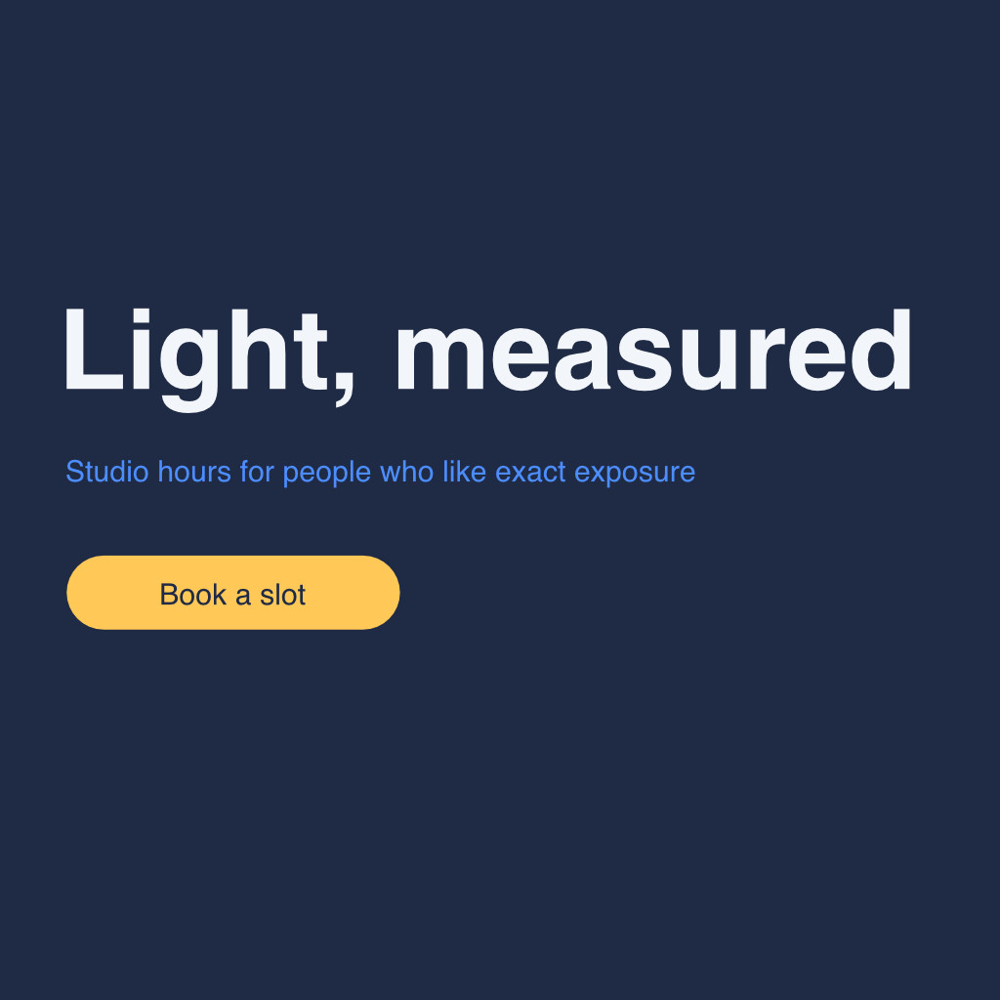

```
affinity-axi run examples/helpers-brand/script.js --with-helpers --brand examples/_brand/brand.json --args '{"uuid":"$DOC"}'
affinity-axi render $DOC --out examples/helpers-brand/render.jpg
```

```
script: examples/helpers-brand/script.js
status: ok
ms: <n>
output[1]:
  {"brand":"Lumen Studio","tokens":["colours.ink","fonts.headline"]}
help[2]:
```

## Fill a template by element name

`fill`: Load a saved .af, set slot:<key> elements from JSON or CSV, save and export one file per record

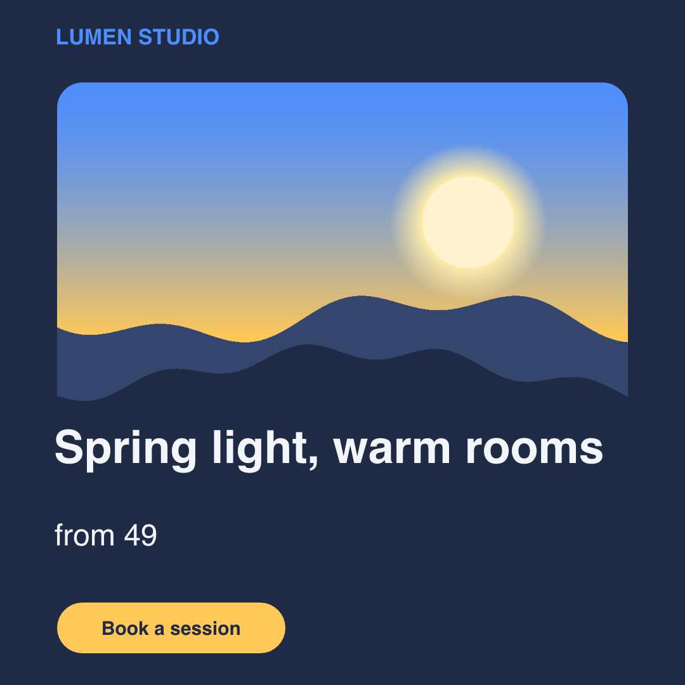

```
affinity-axi run examples/fill/template.js --with-helpers --args '{"uuid":"$DOC"}'
affinity-axi doc save $DOC examples/fill/template.af
affinity-axi doc close $DOC
affinity-axi fill examples/fill/template.af --data examples/fill/posts.json --key slug --out-dir examples/fill --export PNG
```

```
script: examples/fill/template.js
status: ok
ms: <n>
output[1]:
  {"slots":["slot:photo","slot:headline","slot:price","slot:cta"]}
help[2]:
```

## Batch a post series

`batch`: Run one template over every record in a data file, saving and closing each document

```
affinity-axi batch examples/batch/script.js --data examples/batch/data.json --key slug --with-helpers --save-dir examples/batch/af --limit 2
```

```
batch[2]{key,status,doc,ms,note}:
  welcome,ok,<uuid8>,<n>,"saved examples/batch/af/welcome.af, closed"
  lamp-sale,ok,<uuid8>,<n>,"saved examples/batch/af/lamp-sale.af, closed"
summary: ok=2 failed=0 skipped=0 ms=<n>
help[1]:
  affinity-axi   # home view: confirm no documents are left open
```

## Platform sizes

`platforms`: List web and social image sizes with ratio and safe-zone notes (offline)

```
affinity-axi platforms --grep story
```

```
platforms[1 of 44 total]{key,size,ratio,safe,notes}:
  story,1080x1920,9:16,t250 b340,IG/FB Stories 9:16; keep 250 px top and 340 px bottom clear of UI
help[1]:
  in a script: axiArtboards(doc, [{ platform: 'story' }])   # run with --with-helpers
```

## Open a saved asset

`doc-open`: Open a .af, reuse it if already open, and show how it was made and what it contains

```
affinity-axi doc save $DOC examples/doc-open/asset.af
affinity-axi doc open examples/doc-open/asset.af
```

```
saved: examples/doc-open/asset.af
doc: <uuid>
bytes: <n>
dirty: false
manifest: asset.af.axi.json
help[2]:
```

## Read an asset's manifest

`doc-info`: Show how a .af was made and its history from its manifest, without connecting

```
affinity-axi doc save $DOC examples/doc-info/asset.af
affinity-axi doc info examples/doc-info/asset.af
```

```
saved: examples/doc-info/asset.af
doc: <uuid>
bytes: <n>
dirty: false
manifest: asset.af.axi.json
help[2]:
```

## Add a note to an asset

`doc-note`: Record a note in a .af's manifest without connecting

```
affinity-axi doc save $DOC examples/doc-note/asset.af
affinity-axi doc note examples/doc-note/asset.af "Lumen Studio launch card, headline approved"
```

```
saved: examples/doc-note/asset.af
doc: <uuid>
bytes: <n>
dirty: false
manifest: asset.af.axi.json
help[2]:
```

## Inspect a document

`inspect`: List the named elements of an open document with boxes, text, fonts and fills

```
affinity-axi inspect $DOC --named
```

```
doc: <uuid>
path: (unsaved)
size: 1080x1080 px @ 72 dpi
nodes[1]{path,type,name,box,text,font,fill}:
  0/0,Artboard,ig-square,0 0 1080 1080,,,#F2F5F9
note: 1 of 1 nodes (named only)
```

## List saved assets

`assets`: List the .af files under a folder with the script that made them and whether they are unchanged

```
affinity-axi doc save $DOC examples/assets/library/asset.af
affinity-axi assets --dir examples/assets/library
```

```
saved: examples/assets/library/asset.af
doc: <uuid>
bytes: <n>
dirty: false
manifest: asset.af.axi.json
help[2]:
```

## Browse these examples

`examples`: List the examples, show one's commands and sample output, or run it live

```
affinity-axi examples render
```

```
id: render
feature: render
title: Render a preview
summary: Preview the current spread as a JPEG on disk
needs: affinity;document
commands[2]:
```

## Helpers: edit by name

`helpers-named`: Change a text, fill or box by element name, with ambiguity reported as an error

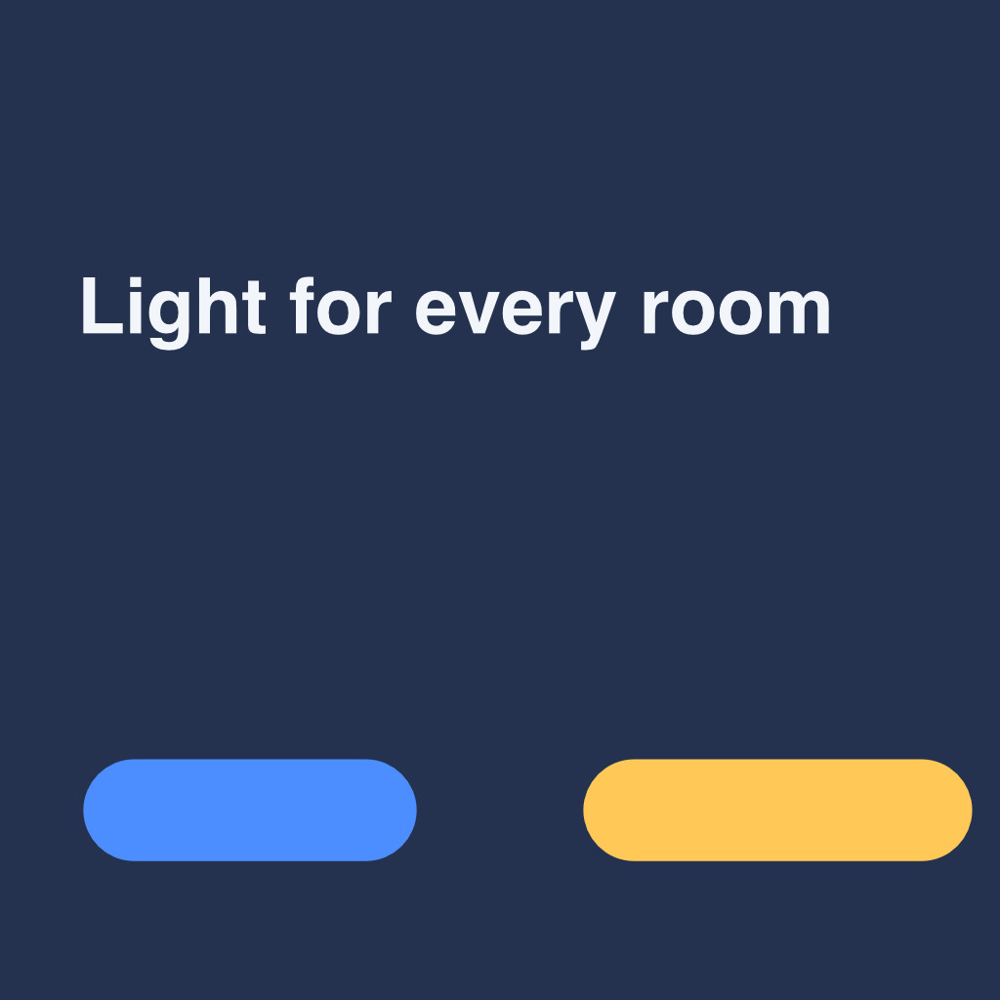

```
affinity-axi run examples/helpers-named/script.js --with-helpers --args '{"uuid":"$DOC"}'
affinity-axi render $DOC --out examples/helpers-named/render.jpg
```

```
script: examples/helpers-named/script.js
status: ok
ms: <n>
output[1]:
  {"named":["ig-square","bg","headline","cta","cta"],"ambiguous":"axiFind: cta is ambiguous (2 matches): ig-square/cta (#0/0/2), ig-square/cta (#0/0/3)"}
help[2]:
```

## Helpers: QR codes

`helpers-qr`: Draw URL and WhatsApp QR codes with a quiet zone and names


```
affinity-axi run examples/helpers-qr/script.js --with-helpers --args '{"uuid":"$DOC"}'
affinity-axi render $DOC --out examples/helpers-qr/render.jpg
```

```
script: examples/helpers-qr/script.js
status: ok
ms: <n>
output[1]:
  {"codes":["lumen-url","lumen-wa"]}
help[2]:
```

## Helpers: logo and favicon vectors

`helpers-vector`: Outline a wordmark, build a mark with boolean ops, export SVG and a 32 px favicon

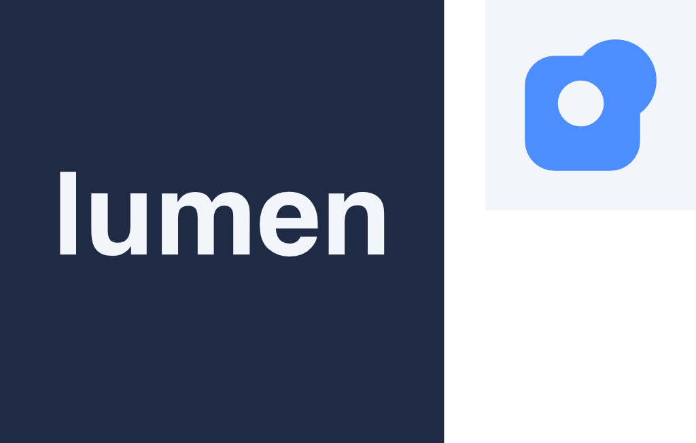

```
affinity-axi run examples/helpers-vector/script.js --with-helpers --args '{"uuid":"$DOC"}'
affinity-axi render $DOC --out examples/helpers-vector/render.jpg
affinity-axi export $DOC "SVG (for export)" examples/helpers-vector/mark.svg --selection
affinity-axi export $DOC PNG examples/helpers-vector/favicon-32.png --artboard mark --square 32
```

```
script: examples/helpers-vector/script.js
status: ok
ms: <n>
output[1]:
  {"mark":"union-subtract","outlined":true}
help[2]:
```

## Helpers: table

`helpers-table`: A price table from an array of rows with a styled header

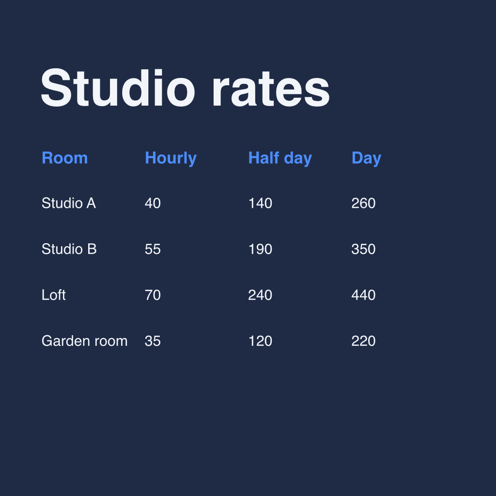

```
affinity-axi run examples/helpers-table/script.js --with-helpers --args '{"uuid":"$DOC"}'
affinity-axi render $DOC --out examples/helpers-table/render.jpg
```

```
script: examples/helpers-table/script.js
status: ok
ms: <n>
output[1]:
  {"rows":5,"cols":4}
help[2]:
```

## Helpers: multi-series charts

`helpers-charts2`: Grouped and stacked bars, a line chart with dots and gridlines, and a legend from plain series

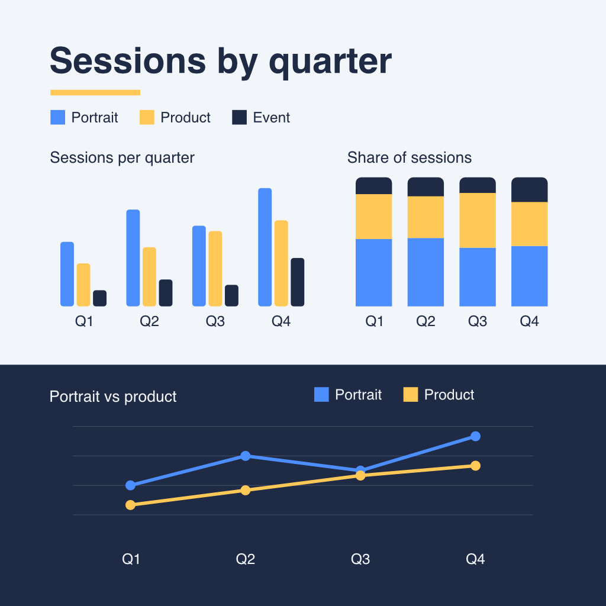

```
affinity-axi run examples/helpers-charts2/script.js --with-helpers --args '{"uuid":"$DOC"}'
affinity-axi render $DOC --out examples/helpers-charts2/render.jpg
```

```
script: examples/helpers-charts2/script.js
status: ok
ms: <n>
output[1]:
  {"groups":4,"series":3,"points":8}
help[2]:
```

## Helpers: pattern tiles

`helpers-pattern`: A seamless background from a motif repeated over a clipped grid, with an optional half-drop

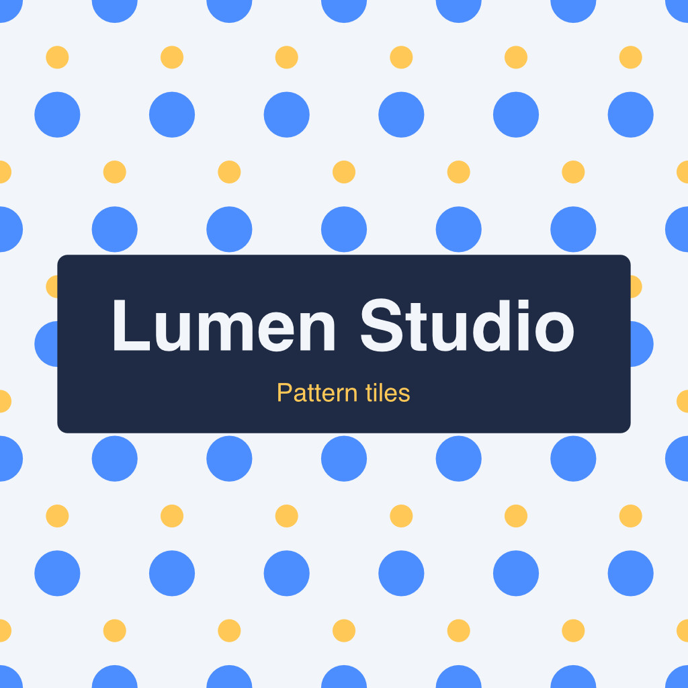

```
affinity-axi run examples/helpers-pattern/script.js --with-helpers --args '{"uuid":"$DOC"}'
affinity-axi render $DOC --out examples/helpers-pattern/render.jpg
```

```
script: examples/helpers-pattern/script.js
status: ok
ms: <n>
output[1]:
  {"cells":49,"seam":0}
help[2]:
```

## List the slot templates

`templates-list`: Print the five ready-made templates with their sizes and fillable slots, offline

```
affinity-axi templates list
```

```
templates[5]{name,size,platform,slots}:
  ig-post,1080x1080,ig-square,headline sub photo cta
  ig-story,1080x1920,story,headline sub photo cta
  carousel-cover,1080x1350,ig-portrait,headline sub photo cta
  og-card,1200x630,og,headline sub cta url
  price-post,1080x1080,ig-square,headline sub footnote cta
```

## Build a template and fill it

`templates-new`: Build the ig-post template on a brand kit, save it as .af, then fill it from two records and export PNGs


```
affinity-axi templates new ig-post --out examples/templates-new/ig-post.af --brand examples/_brand/brand.json --args '{"photo":"examples/templates-new/photo.png"}'
affinity-axi fill examples/templates-new/ig-post.af --data examples/templates-new/posts.json --key slug --out-dir examples/templates-new --export PNG
```

```
template: ig-post
doc: <uuid>
saved: examples/templates-new/ig-post.af
slots[4]: headline, sub, photo, cta
help[2]:
  affinity-axi fill examples/templates-new/ig-post.af --data <records.json> --out-dir <dir> --export PNG
```

## Print PDF with preflight

`print`: Export a press PDF (default PDF/X-4) and preflight it offline: boxes, bleed, colour, fonts

```
affinity-axi run examples/print/script.js --with-helpers --args '{"uuid":"$DOC"}'
affinity-axi print $DOC --out examples/print/poster.pdf
```

```
script: examples/print/script.js
status: ok
ms: <n>
output[1]:
  {"poster":"ig-square"}
help[2]:
```

## Helpers: print sheet and crop marks

`helpers-print`: A proof sheet with bleed, slug, eight locked crop marks and trim and bleed guides

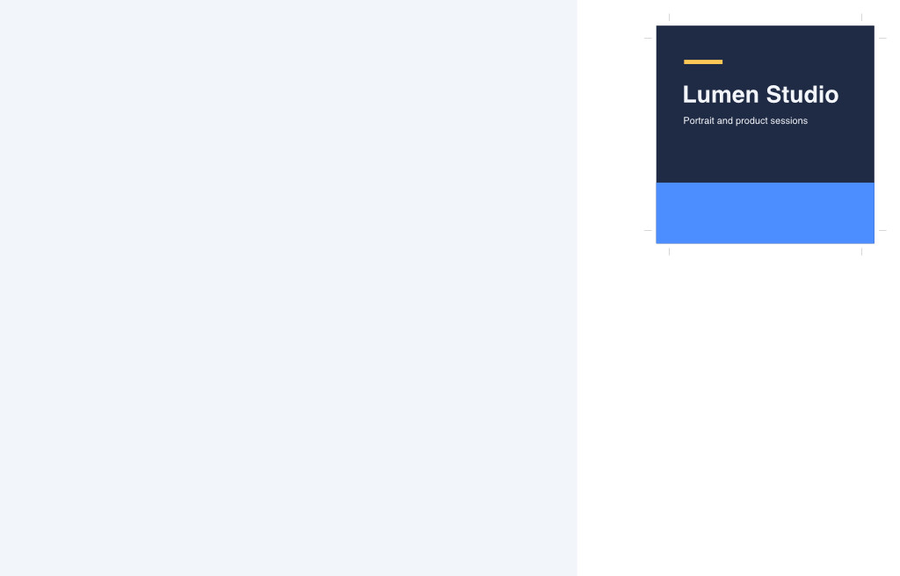

```
affinity-axi run examples/helpers-print/script.js --with-helpers --args '{"uuid":"$DOC"}'
affinity-axi render $DOC --out examples/helpers-print/render.jpg
```

```
script: examples/helpers-print/script.js
status: ok
ms: <n>
output[1]:
  {"marks":8}
help[2]:
```

## Google Display ad sizes

`platforms-ads`: The seven standard display ad sizes with their 150 KB limit

```
affinity-axi platforms --grep "^ad-"
```

```
platforms[7 of 44 total]{key,size,ratio,safe,notes}:
  ad-300x250,300x250,6:5,-,Google Display medium rectangle; 150 KB max; export --max-kb 150
  ad-336x280,336x280,6:5,-,Google Display large rectangle; 150 KB max; export --max-kb 150
  ad-728x90,728x90,8.09:1,-,Google Display leaderboard; 150 KB max; export --max-kb 150
  ad-160x600,160x600,4:15,-,Google Display wide skyscraper; 150 KB max; export --max-kb 150
  ad-300x600,300x600,1:2,-,Google Display half page; 150 KB max; export --max-kb 150
```

## Design checks

`lint`: Contrast, safe zones, small text, slot names and off-kit colours, as a table with severities

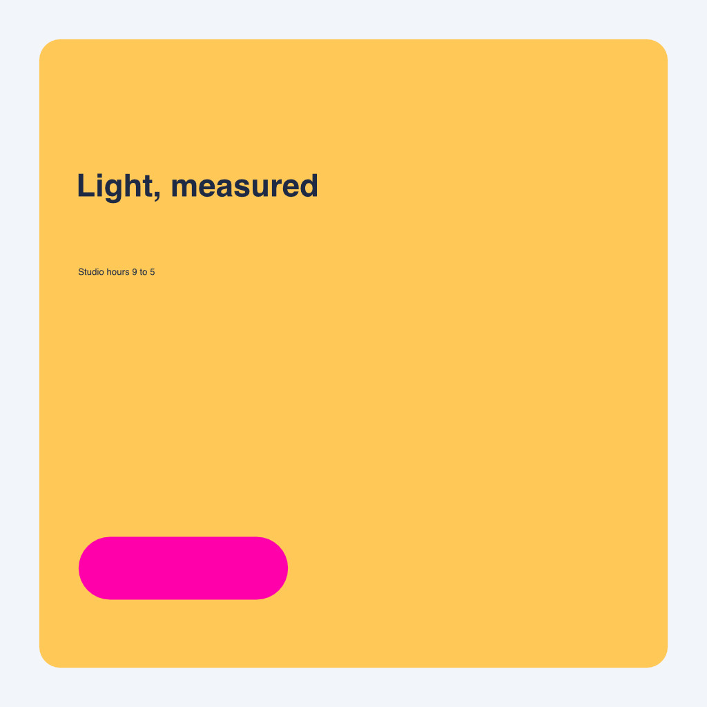

```
affinity-axi run examples/lint/script.js --with-helpers --args '{"uuid":"$DOC"}'
affinity-axi lint $DOC --brand examples/_brand/brand.json
affinity-axi render $DOC --out examples/lint/render.jpg
```

```
script: examples/lint/script.js
status: ok
ms: <n>
output[1]:
  {"planted":["caption 14 px","pill #FF00AA"]}
help[2]:
```

## Export under a file-size budget

`export-budget`: Step JPEG, WebP or PNG presets and then size until the file fits --max-kb


```
affinity-axi export $DOC "JPEG (High quality)" examples/export-budget/ad.jpg --artboard ig-square --max-kb 40
```

```
export: examples/export-budget/ad.jpg
doc: <uuid>
preset: JPEG (High quality)
artboard: ig-square
budget_kb: 40
attempts[1]{preset,size,bytes,fit}:
```

## Alt-text stub on export

`export-alt`: Every exported image prints an alt-text stub built from the document's text, top-down

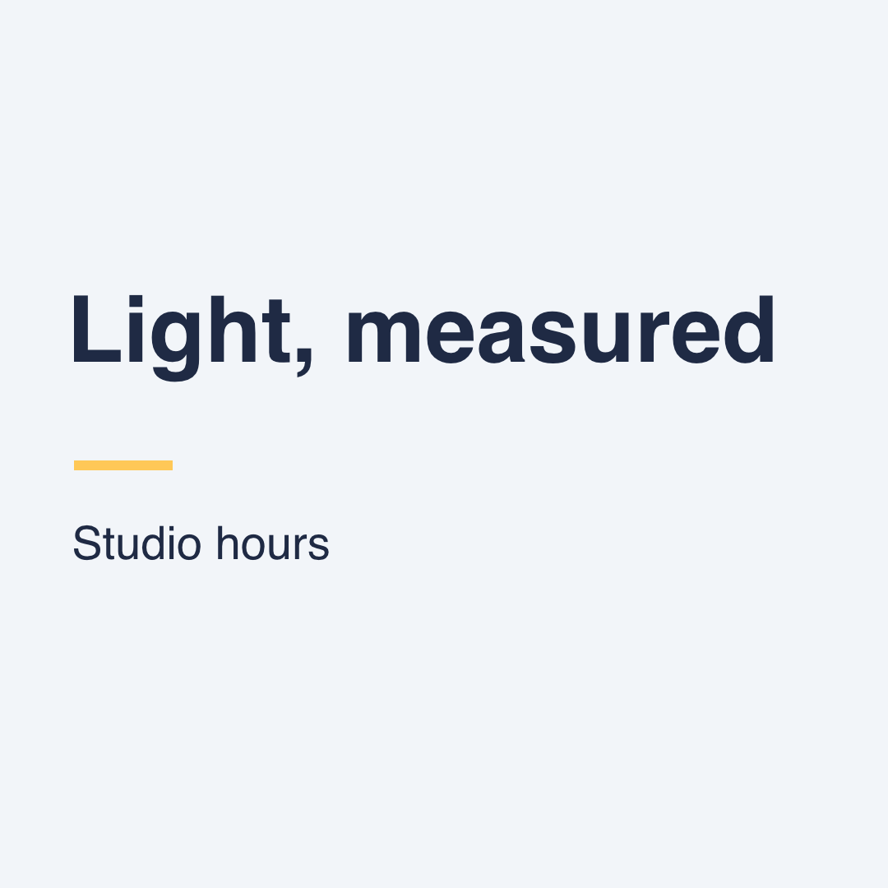

```
affinity-axi run examples/export-alt/script.js --with-helpers --args '{"uuid":"$DOC"}'
affinity-axi export $DOC PNG examples/export-alt/card.png --artboard ig-square
```

```
script: examples/export-alt/script.js
status: ok
ms: <n>
output[1]:
  {"added":["bg","rule","headline","hours"]}
help[2]:
```
